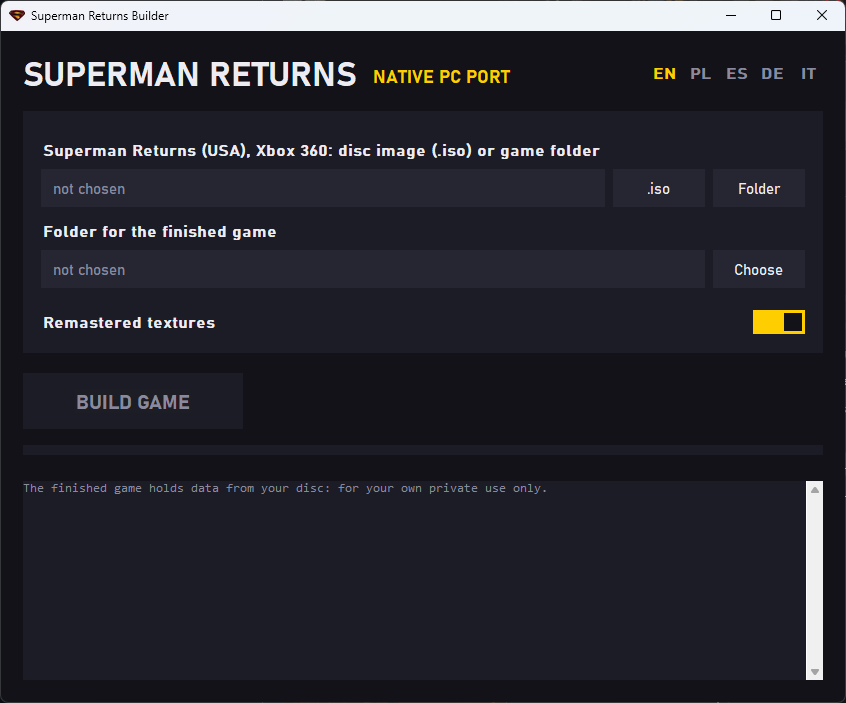

### Superman Returns PC

A native PC port of Superman Returns (Xbox 360). The game is built from your own copy of the game with the builder.

### Building the game

1. Download `Superman.Returns.Builder.exe` from [Releases](https://github.com/gangg111/Superman-Returns-PC/releases/latest).
2. You need **Superman Returns (USA) for Xbox 360**: a disc image (`.iso`) or a game folder with `default.xex` and `DATA`. Other releases (EUR and others) are not accepted.
3. Run `Superman.Returns.Builder.exe` and pick your game with **.iso** or **Folder**. The note on the right says **recognized** when it is the right release.
4. Pick the **folder for the finished game** with **Choose**. It needs about 7 GB free; the finished game takes about 5.4 GB.
5. **Remastered textures**: on adds the new moon, ocean waves, sand, lit office windows at night and the street lamps; off keeps the game's original textures.
6. Press **BUILD GAME** and wait until the log says **Done**. The game is in the `Superman Returns` folder inside the folder you picked.
7. Start `superman_returns.exe` from that folder. Every setting is in the game's menus: pause menu (Esc) > OPTIONS.

The finished game holds data from your own disc: it is for your private use only, do not share it.
