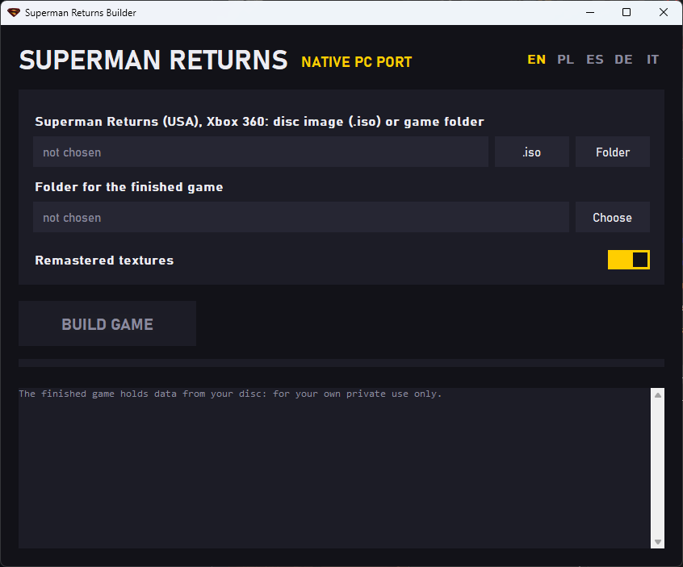

<h3 align="center">Superman Returns PC</h3>

  <a href="https://github.com/gangg111/Superman-Returns-PC/releases/latest"><b>Download</b></a> ·
  <a href="#get-started">Get started</a> ·
  <a href="docs/MODS.md">Mods</a> ·
  <a href="https://github.com/gangg111/Superman-Returns-PC/issues">Issues</a> ·
  <a href="https://github.com/gangg111/Superman-Returns-PC/releases">Changelog</a>

**Superman Returns PC** is a work-in-progress static recompilation of *Superman Returns* (Xbox 360, USA release)
into a native application for Windows, built from your own copy of the game.

> [!CAUTION]
> **No game files are included.** You need your own legally obtained copy of **Superman Returns (USA) for Xbox
> 360**, as a disc image (`.iso`) or a game folder with `default.xex` and `DATA`. This project does not provide game
> files, disc images or instructions on how to obtain them. The builder makes the game on your machine, from your
> files.

> [!NOTE]
> **Made almost entirely with AI.** Nearly all of the code, tooling, reverse engineering and documentation is
> written by an AI (Anthropic's Claude, through Claude Code), directed, tested and reviewed by a human. It builds on
> [superman_returns_recomp](https://github.com/MrPowerUp82/superman_returns_recomp) by MrPowerUp82 and the
> [ReXGlue SDK](https://github.com/rexglue/rexglue-sdk). If you don't trust code written by AI, you can simply
> ignore this project.

> [!WARNING]
> **This is an alpha.** The port is still in development, so expect bugs and crashes in some places. Please report
> every bug you find (see [Found a bug?](#found-a-bug)). Every review and release test is done by one person with
> limited hardware.

### Features

- The whole game from your own disc, made by a one-click builder in English, Polish, Spanish, German and Italian
- 60 FPS, 120 FPS or unlimited, with the game's scripts kept at the console's 30 Hz so cutscenes and fights behave
- Resolutions up to 4K, render scale up to 400%, fullscreen or windowed, VSync
- Ray-traced shadows and reflections, softer or sharper shadows, larger shadow maps
- NVIDIA DLSS (Performance, Balanced, Quality, DLAA), MSAA, FXAA and texture filtering up to 16x
- Time of day of your choice and a day cycle from 10 minutes to 6 hours, with lit office windows at night
- Remastered textures (moon, ocean waves, sand, night windows, street lamps), switchable in the builder
- Brightness and contrast sliders for the whole picture, menus and HUD included
- Keyboard and mouse with two keys per action, mouse speed and Y-axis inversion, and any controller: Xbox pads,
  DualShock 4 and DualSense over USB or Bluetooth
- Button prompts that match your device: Xbox, PlayStation or your bound keys, fight prompts included
- A main menu with New Game, Load Game and Options, so every setting can be changed before you play
- Texture mods with your own PNG or DDS files, and three costume slots of your own in the Fortress of Solitude
  ([Mods](docs/MODS.md))
- Lower CPU use than the console's busy loops: about 2 CPU cores at 60 FPS instead of 6

### Get started

**You need:** your own Superman Returns (USA) for Xbox 360, Windows 10 or 11 (64-bit), a GPU with DirectX 12 and
about 7 GB of free disk space (the finished game takes about 5.4 GB). Ray tracing needs a GPU with DXR 1.1 and DLSS
an NVIDIA RTX card; on other GPUs those options are greyed out and the game runs without them.

1. Download `Superman.Returns.Builder.exe` from [Releases](https://github.com/gangg111/Superman-Returns-PC/releases/latest).
2. Run it and pick your game with **.iso** or **Folder**. The note on the right says **recognized** when it is the
   right release. Other releases (EUR and others) are not accepted.
3. Pick the **folder for the finished game** with **Choose**, and leave **Remastered textures** on for the new
   textures or turn it off for the original ones.
4. Press **BUILD GAME** and wait until the log says **Done**. The game is in the `Superman Returns` folder inside
   the folder you picked. Your disc image or game folder isn't changed.
5. Play: start `superman_returns.exe`. Every setting is in the game's menus: main menu or pause menu (Esc) >
   OPTIONS.

**Updating:** download the new builder and run it again over the same disc image or game folder, into the same
folder. Your settings, key bindings, texture mods and costume slots stay.

### Saves

Saves are in `Documents\superman_returns`. When Windows blocks writes there (Controlled folder access, a read-only
or redirected Documents folder), the game keeps them in `%LOCALAPPDATA%\superman_returns` instead and copies the
saves you already have. To back them up or move them, close the game and copy the whole folder.

### Texture mods and costumes

You can replace any texture, for example Superman's suit, with your own PNG: put it in the `textures` folder next
to `superman_returns.exe`. The Fortress of Solitude's Costumes screen also has three slots of your own (4, 5 and
6): paint the suit's PNGs in `textures\Suits\Slot4` and name the costume in its `costume.toml`. How to find a
texture's name, the costume files and the colour of the cape's inside: [Mods](docs/MODS.md).

### Controls

Any controller works. Keyboard and mouse defaults, by the pad button they stand for:

| Pad | Key | Pad | Key |
|---|---|---|---|
| Left stick (move) | W A S D | Right stick (camera) | Mouse, Left / Right arrows |
| Y (fly) | Space | A | F |
| X | Left click | B | Ctrl |
| RT | Left click | LT | Right click |
| RB | Shift | Start (pause) | Esc |
| Back | M | D-pad up / left / right | 1 / 2 / 3 |

Every action can have two keys, rebound in OPTIONS > KEYS MAPPING; the mouse speed is in OPTIONS > MOUSE OPTIONS.
The game's hints show the key you bound.

### Found a bug?

Use the latest release, search the [existing issues](https://github.com/gangg111/Superman-Returns-PC/issues?q=is%3Aissue)
and [open one](https://github.com/gangg111/Superman-Returns-PC/issues/new) with your CPU, GPU, a screenshot and the
newest `superman_returns_NNN.log` from the `logs` folder next to `superman_returns.exe`. If it happens at a certain
place in the game, say where.

### Respect copyright

- *Superman Returns* was developed by EA Tiburon and published by Electronic Arts. Superman and all related
  characters are trademarks of DC Comics. This is a fan project. It is not affiliated with, endorsed by or
  sponsored by any of them.
- This repository and the builder contain no game files, no game code, no assets and no disc images. The builder
  checks that none of the game's files is inside it.
- The game folder the builder makes holds data from your own disc. It is for your own use only: don't share it,
  upload it or ship it.
- Issues or discussions that contain game files or links to pirated copies will be removed. Piracy is not supported
  in any way.
- Follow the copyright laws of your country. Making a copy of a game you own for personal use is legal in some
  countries and not in others; that is your responsibility.

### Credits

Built on **[superman_returns_recomp](https://github.com/MrPowerUp82/superman_returns_recomp)** by MrPowerUp82 and the
**[ReXGlue SDK](https://github.com/rexglue/rexglue-sdk)** (with SDL3, fmt, xxHash and others), with
[XenosRecomp](https://github.com/hedge-dev/XenosRecomp) (MIT) for the shaders and the
[DirectX Shader Compiler](https://github.com/microsoft/DirectXShaderCompiler). The builder carries FFmpeg (LGPL 2.1)
for the sound conversion; its licences are in `FFmpeg-licenses.zip` on every release. PlayStation button icons:
generated with AI after "PlayStation 5 Button Icons & Controls" by Zacksly (CC BY 4.0) as the reference. The licenses
of everything the game folder bundles are in its `licenses` folder and `THIRD_PARTY_NOTICES.txt`.
